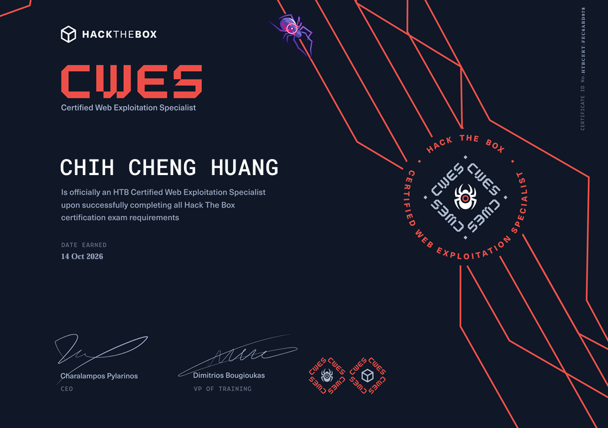

## 前言
在碩一剛開學的時候，突然意識到國科會計畫開始的話就完全沒時間考證照了，趕緊的報名 CWES，考試安排在中秋連假，也很順利的「烤」到了。

## 準備建議
1. 內容都涵蓋在 CWES 的學習路徑中，不太需要額外去找靶機練習，把學習路徑中的內容都弄熟基本上不太會有問題。
2. 閱讀學習路徑的時候要邊做筆記，整理自己的方法論，如果可以照方法論，在不看 Writeup 的情況下打出 skill assessment 就差不多了。

## 考試建議
在考試的過程中，肯定會有沒想法的時候，如果你正在考試或即將考試，正在焦慮的時候看到我這篇文章，我只會跟你說，從頭把筆記所有的細節測過一次，然後「不要放棄 ! 不要放棄 ! 不要放棄」，拿到 flag 的時候你就會懂我在說什麼了。 XD

## 結語
我總共花了 5 天，拿了 8 個 flag 並完成報告，考試我覺得難度適中，下一張我會挑戰 CPTS，希望可以在碩士畢業前拿到，繼續努力!

另外，很多人說考試等個 4、5 天就審核過了，但我好像運氣沒那麼好，等了足足 16 天（含假日），我猜 HTB 一定是想給我一個驚喜！不過結果是好的就好啦，快樂快樂。

最後最後，附上我的證照啦 !

